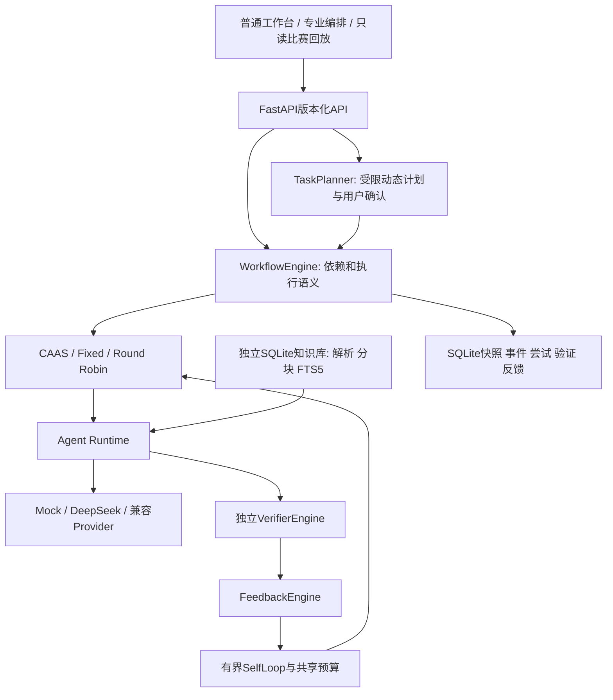

# 项目定位、系统架构与技术栈

项目面向复杂任务的可控多Agent协作：让普通用户输入需求、审查计划并取得可追溯交付；让专业用户配置角色、模型、工具、知识库和可执行工作流。目标赛道为用户指定的2026第五届未来精英创新大赛Agent编排创新应用。没有已验证商业客户、用户规模或落地机构，不填写此类指标。

技术栈：Windows本地环境、Python3.11、FastAPI、SQLite、Vue3/TypeScript/Vite、VueFlow、ECharts、jsonschema、httpx、pypdf。模型通过可替换Provider接入，Mock默认安全模式。知识库无需付费Embedding。

分层方向：domain类型/状态 → application端口及流程 → adapters数据库/模型/工具 → api组合根。bootstrap选择具体实现。工作流管理执行顺序和跳过，调度器只处理合格候选和容量，Runtime只负责单Agent推理和受限工具执行；验证不由生成Agent自报成功决定。

只读replay为独立应用，加载已有脱敏证据包，无写入接口、无模型执行入口；普通/专业工作台共用真实引擎。SQLite知识库与执行记录分文件，历史真实证据不写入版本仓库。
