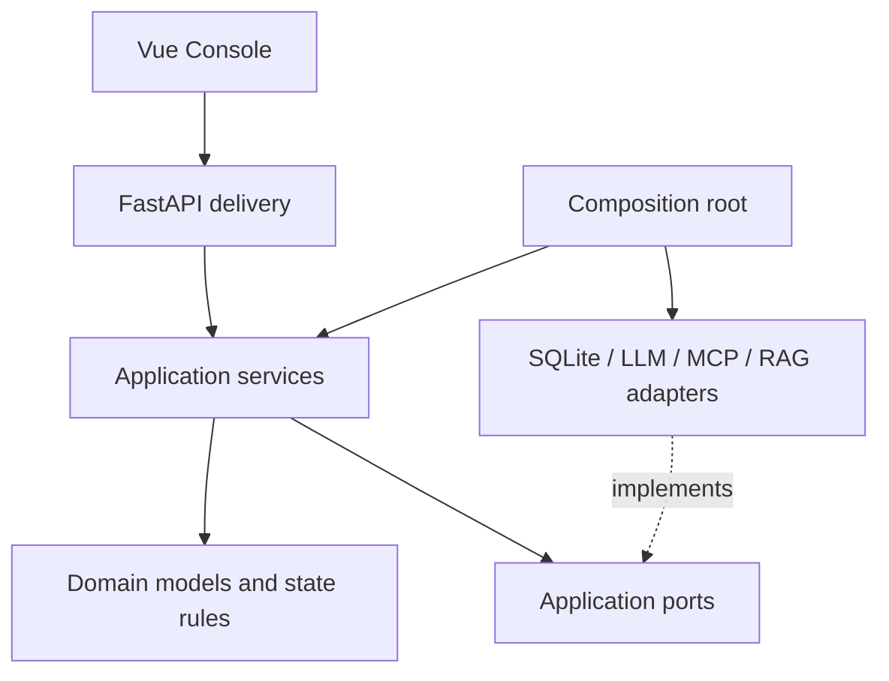
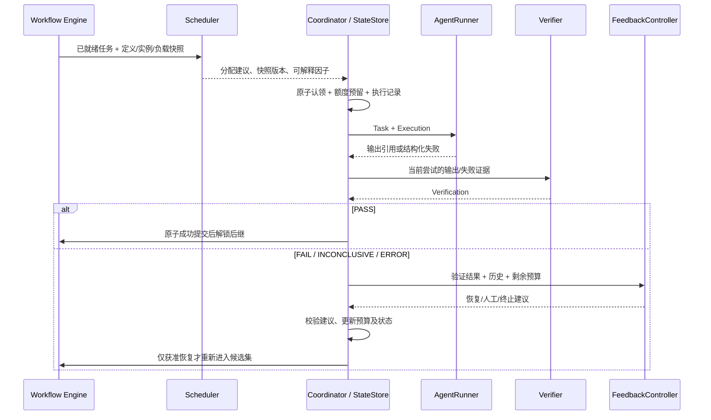

# FutureCup 平台架构设计

> **任务 08 当前实现**：新增服务端 ProviderProfile/ModelPolicy、受限地址及模型白名单，复用 OpenAICompatibleProvider 接入 DeepSeek、Qwen 和兼容协议。原 Runtime 执行有限重试并逐次计预算/Token，模型能力不支持时明确失败；配置估算与实际账单分开。前端增加模型目录和用量显示，Key 不返回浏览器。原有 270/16 项测试保留，当前 322 项后端、22 项前端测试及构建通过；三场景经过本地 HTTP Mock 预演。**未发起真实模型请求，不宣称真实推理或修复效果已验证。**任务 07 本地基线为 `37a9770`。详见 [real-llm-integration-08.md](real-llm-integration-08.md)。

## 任务 08 的 Provider 与预算边界

模型配置只由服务端环境注入，包含精确模型列表、能力、地址、超时、重试、价格和版本；密钥只引用环境变量名。全局开关与 Provider 开关同时开启才允许真实适配器参与执行，查询配置不会自动发送模型请求。前端可选择模型，不能修改 HTTP 转发目标或保存 Key。

Provider 继续实现原 LLMProvider 端口；WorkflowEngine、CAAS、VerifierEngine 和 Self-Loop 的职责不变。传输重试由 Runtime 计数，不在 HTTP 适配器中隐藏；每次尝试消耗同一个执行/根工作流预算，取消和整体超时不因退避重置。每次调用、节点和恢复尝试记录请求/返回模型、配置版本、用量完整性及配置费用估算，失败未知用量不会当作免费。

原 JSON/工具回传路径通过显式能力策略控制，支持文本、Prompt JSON 和声明支持的原生 JSON Object；不将不同供应商/模型的工具和结构化能力视为等价。非思考模式工具上下文已有模拟协议验证，思考模式工具历史仍不支持。DeepSeek/Qwen/自定义地址校验、DNS 公网检查和已知凭据防泄漏位于适配层，不把这些机制宣称为完整沙箱。

三套面向真实业务的工作流定义与独立规则存放于前端共享 JSON，后端测试和 HTTP 预演复用；由实际运行引擎执行，模型输出明确为 Mock。接入真实模型后的连通、数值/语义质量和真实账单核对必须由后续授权联调取得，不由本阶段模拟结果推断。

> **任务 07 当前实现**：Vue 3 管理平台已接入真实 API，包含总览、Agent 配置、Vue Flow 编排、运行监控和执行因果链。新增有界总览/执行查询、只读工作流预检及保留私有 Prompt 的配置更新；没有改写 CAAS、工作流控制或 Self-Loop 算法。任务 06 已保存为本地提交 `18f39a9`。当前 270 项后端测试、16 项前端单元/DOM 模拟测试、TypeScript 与生产构建通过；真实 HTTP/Vite 代理通过。浏览器操作、真实布局/拖拽和截图因工具安全停止**未验收**，不能由 jsdom 测试代替。详见 [frontend-platform-07.md](frontend-platform-07.md)。

## 任务 07 的前后端边界

Vue Router 组织五个页面，api.ts 统一同源请求、超时和错误反馈，types.ts 对齐后端 DTO。总览统计由后端从最近最多 200 个根工作流及其子流程验证生成；成功率/验证率分别标明分母，不从静态假数据计算。运行列表默认轮询，因果链展示失败尝试和隔离产物，不把执行成功等同于可信验证。

画布节点/连线编码为原 WorkflowDefinition；坐标作为浏览器本地布局单独保存，不改变工作流执行模型。条件、汇合、受限循环和子流程调用原生控制语义，验证位于任务配置。保存与执行前通过 WorkflowEngine.validate 复用提交预检；不可覆盖旧版本。私有 Prompt 不回读，省略 Prompt 的 PATCH 更新由服务端保留原值。

三份共享 JSON 示例由前端、后端测试与 HTTP 验收共同使用。明确的 mock-repair-demo 只提供脚本化模型输出，实际编排、调度、验证和恢复由原引擎运行；不代表真实 LLM 修复能力。没有新增认证体系、全局 CORS、WebSocket、协同编辑或任何自动付费模型访问。

> **任务 06 当前实现**：已接入独立 VerifierEngine、FeedbackEngine 和有界 SelfLoopEngine，复用原 WorkflowEngine、三种调度策略和 Agent Runtime。新增规则/产物版本绑定、共享调用与资源准入预算、取消传播、人工授权恢复、SQLite 审计及过期反馈拒绝。原 183 项测试保持不变，新增 79 项，共 262 项通过；模型演示均为 Mock。任务 05 提交 `1f3f658` 已确认，本次未重复提交。完整设计、限制及证据见 [verification-selfloop-06.md](verification-selfloop-06.md)。下文任务 01—05 的说明及检查是历史记录，以本条和任务 06 开发记录为当前实现边界。

## 任务 06 的必要架构接入

- `WorkflowDefinition.resource_limits` 定义根级共享资源限制，子工作流继承同一个账本；旧定义使用兼容默认值。任务节点新增 `verification` 和 `recovery` 配置，显式选择规则、有限修复及备用路径。
- `VerificationResult` 包装原 Verification，附加 attempt、规则摘要、产物版本/摘要及逐项依据；FeedbackReport 包装原 Feedback。复用既有 VERIFYING、RECOVERING、WAITING_HUMAN 和 PAUSED 状态，没有建立第二套 Agent 运行系统。
- WorkflowEngine 的 DAG 就绪判定后进入原 SchedulingCoordinator；每次恢复重新获得独立 attempt ID，但候选 Agent/版本和权限不能越过工作流提交时的边界。原 Agent 重试与更换 Agent 都经过相同容量准入检查。
- 生成产物先隔离，独立验证 PASSED 后核对当前版本并发布，随后才把节点置为 SUCCEEDED。失败、ERROR、INCONCLUSIVE 均不能进入下游成功输出；未配置验证的旧流程明确保持 verified=false。
- FeedbackEngine 对产物、工具、模型调用、环境及验证器故障分开处理；验证器异常不归咎于 Agent，工具/环境异常不自动触发能力降级。CAAS 原执行可靠性与独立质量证据保持不同统计渠道。
- 新 VerificationBackend / SafetyRepository 端口隔离哈希、JSON Schema 与 SQLite。服务端注册的外部测试接口只接纳绑定产物摘要的结构化证据；没有任意代码执行、Shell 或虚构的安全沙箱。
- 人工等待不重置总超时，不放宽预算、权限或规则；只允许经服务端配置令牌授权的 retry/abort。重启将运行及暂停中的工作流标为中断失败，过期人工工单失效。

所有新字段有兼容默认值；SQLite 新增独立审计表，原快照解码兼容历史字段缺省。当前事务与容量原子性仍限定单进程/事件循环，不声称支持分布式调度或自动崩溃续跑。

> 本文保留任务 01 的总体提案和历史检查结果。任务 03 已实现单 Agent Runtime 子集，兼容性调整、实现边界和最新测试结果见 [任务 03 开发记录](agent-runtime-03.md)；工作流、调度、验证和反馈闭环仍是后续设计。

> 任务 04 已实现工作流编排、SQLite 快照和事件，最新语义与验收见 [任务 04 开发记录](workflow-engine-04.md)。本阶段以 `verified=false` 明确表示执行级成功，未实现原提案中的可信验证门禁；智能调度、验证和反馈闭环仍待后续阶段。

> 任务 05 已在原 WorkflowEngine 中接入 CAAS / fixed / Round Robin、能力画像和统一 Runtime 原子认领，设计、公式、实验与限制见 [scheduler-05.md](scheduler-05.md)。就绪判断仍由工作流负责，画像统计、选择和容量约束由调度器负责；可信验证和反馈自循环仍未实现。原任务 04 工作已保存为本地提交 a5783cb。

状态：提案，待负责人审核。日期：2026-10-28。本文中的运行机制、状态转换、存储约束及 API 规划均为设计，除明确标注的健康端点外尚未实现。源码中的 dataclass / Protocol 只表达契约，不执行校验、调度或恢复。

## 1. 范围与设计取舍

平台负责复杂任务的编排、能力发现、执行分配、证据验证、受限恢复及审计。LLM 是 Agent 推理核心，通过模型端口接入；流程控制、权限、预算、状态转换和最终验收不能由 LLM 自行绕过。

本阶段交付领域契约、端口、FastAPI 存活检查、Vue 工程入口和实验设计。没有引入大型 AI 框架，没有付费请求、Agent 执行、持久化实现或核心调度算法。初始目录为空，未覆盖或删除用户已有内容。

环境不满足目标运行条件：本机 Python 3.13.9 / launcher 3.14，未发现 3.11；FastAPI、Uvicorn 未安装；Git 命令未找到。Node 24.11.0 / npm 11.6.1 可用；npm 全局清单因全局目录不存在失败，不证明前端依赖可用。因此只建立可静态检查的骨架，不安装依赖或启动完整服务。`pyproject.toml` 约束 3.11，避免用现有解释器意外安装目标工程。

## 2. 模块及依赖

| 模块 | 职责 | 设计理由 |
| --- | --- | --- |
| Agent Registry | 角色、技能、工具、模型配置、记忆域、权限配置、版本注册与发现 | 定义版本和运行实例分离，能力匹配不依赖某个模型 SDK |
| Workflow Engine | 校验工作流、展开节点、依赖解锁、分支、循环和子流程 | 控制逻辑独立于单个 Agent；LLM 规划须编译为可校验定义 |
| Scheduler | 根据能力、负载、依赖、优先级提出分配建议与解释 | 可替换策略、可对照实验，不直接调用工具或写入状态 |
| Execution Coordinator / Agent Runner | 原子认领、租约、执行尝试、取消、模型与工具调用 | 协调器管理事实状态，Runner 管理一次推理执行 |
| Verification | 格式、约束、工具测试、交叉检查和人工验收 | 执行完成与任务成功分离，结论绑定证据和验证器版本 |
| Feedback Controller | 依据验证和历史提出重试、换 Agent、重规划、人工或终止 | 闭环由明确预算约束；不能直接修改权限或成功状态 |
| Persistence / Observability | 状态、事件、中间产物、追踪和恢复 | 保留因果链，支持重放、审计和实验采集 |
| Security / Tool Gateway | 权限、人工批准、工具白名单、隔离和脱敏 | 所有工具入口使用同一策略，MCP 也不能旁路 |
| Benchmark Harness | 相同任务、预算和验收下切换策略 | 度量平台机制的效果，不用演示数据冒充实验 |
| HTTP API / Vue Console | 将命令交给应用层，展示查询与人工操作 | 前后端独立构建，浏览器不直接持有模型密钥或执行工具 |



依赖原则：领域层仅依赖标准库；应用层依赖领域和端口；适配器实现端口；HTTP 层通过组合根注入应用服务。内部不得 import FastAPI、模型 SDK 或 SQLite 实现。当前 `api/app.py` 只是最小组合入口，未来业务装配放入独立 bootstrap 模块。适配器尚无实现，因此不会有“默认假模型”或静默成功。

## 3. 运行架构与持久化

第一版建议单机、单协调器进程：FastAPI 负责命令及查询，受管理的异步 worker 执行任务，通过 SQLite 保存事实状态；工作流不能仅放在 FastAPI BackgroundTasks 或内存队列中。工具在独立受限进程运行。Windows 初期使用明确的受控工作目录、进程超时和最小权限；真正的文件系统/网络隔离要经负责人选择并验证的沙箱承担，Python 子进程本身不构成安全沙箱。

SQLite 采用迁移脚本、外键、短事务，后续按实测评估 WAL / busy_timeout。不得在 LLM 等待期间占用写事务。初期不支持多 Uvicorn worker 并发调度；未来可以拆分协调器、持久任务队列和执行 worker，再替换数据库适配器。当前未创建 SQLite 文件、表或迁移。

建议表：`agent_definitions`、`agent_instances`、`workflow_definitions`、`workflow_runs`、`tasks`、`executions`、`verifications`、`feedbacks`、`runtime_events`、`artifacts`、`approvals`。定义采用 `(id, version)` 唯一且不可变；运行实体采用 `id + revision` 乐观锁；事件采用唯一 ID 和聚合内单调序号；尝试采用 `(task_id, attempt)` 唯一。大产物放受控 ArtifactStore，数据库保存哈希、媒体类型、路径引用和来源，禁止在日志中内联密钥或完整敏感输入。

`StateStore.claim` 一次事务检查任务版本、实例版本、可用状态、心跳、容量和幂等键，完成容量预留、Execution 创建、任务 ASSIGNED 与事件记录；建议失效则重新读取快照，不强行覆盖。`commit` 原子更新版本和相关执行/验证/反馈记录、事件；执行终结时释放租约和负载。单个 attempt 不得重复扣减容量。执行更新需要检查执行 revision，过期 worker 的结果不得覆盖新 attempt。未来实现须测试竞争条件和重复提交。

事件表同时作为简化 outbox：提交后发布到 EventSink，失败可重放，消费者按事件 ID 去重。采用至少一次投递；不承诺任意外部工具 exactly-once。副作用工具必须支持幂等键，或提供可查询状态/补偿路径；结果未知时进入人工处理，禁止盲目重试。

## 4. 核心数据契约

源码见 `backend/src/futurecup/domain/models.py`。ID 为不透明字符串，时间必须为 UTC aware；HTTP 层未来做格式转换。definition `version` 为不可变业务版本，`revision` 为并发控制计数，两者用途不同。`frozen=True` 只禁止属性重绑定，不深度冻结 JSON；未来入口校验并复制配置，持久化时按版本和哈希快照。

| 实体 | 关键字段 | 关键规则 |
| --- | --- | --- |
| AgentDefinition | ref、role、skills、tool_refs、model_profile、memory_namespace、permission_profile、max_concurrency | 模型配置与凭据分离；工具和技能可被发现；定义不可原地修改 |
| AgentRuntime | instance_id、agent_ref、state、active_executions、heartbeat_at、revision | 同版本可有多个实例；负载由协调器事实计算，不能信任模型自报 |
| Task | workflow_run_id、node_instance_id、required_skills、dependency_ids、priority、input_refs、verification_profile、permission_profile、recovery_policy、state、revision | 只消费已验证的依赖结果；工作流节点实例与逻辑任务对应 |
| WorkflowDefinition / Run | nodes、edges、输入输出 schema、max_subworkflow_depth；definition_ref、parent_run_id、policy、state、revision | 定义与运行分离；运行固定版本，子运行继承父级预算约束 |
| Execution | task_id、attempt、agent_ref / instance_id、strategy_ref、idempotency_key、state、lease_expires_at、起止时间、output_refs、error_code、revision | 一次尝试一条记录；执行正常返回并不等于任务通过验证 |
| Verification | execution_id、verifier_ref、verdict、evidence_refs、reason_codes、created_at | PASS / FAIL / INCONCLUSIVE / ERROR；验证器异常不能算通过 |
| Feedback | task_id、verification_id、action、reason、strategy_patch、created_at | 保留策略调整及原因；patch 只能修改白名单配置，不得提升权限 |
| RuntimeEvent | run_id、aggregate_id、sequence、type、occurred_at、payload | 串联中间结果、调度解释、模型/工具调用、验证、恢复及人工动作 |

`RecoveryPolicy` 定义总尝试数、重规划数、连续无进展上限、绝对截止时间、token 和费用预算。预算使用整数费用单位，单位须由模型价目配置统一并版本化。下一阶段还需增加持久化 BudgetLedger（已用/预留额度）、授权记录、取消令牌与人工决定模型；当前不能声称已有预算执行或权限执行能力。

### 状态转换设计

Agent：`REGISTERED → AVAILABLE → DRAINING → OFFLINE → RETIRED`；心跳失效 `AVAILABLE → OFFLINE`，恢复 `OFFLINE → AVAILABLE`；允许 `DRAINING → AVAILABLE` 撤销排空。RETIRED 为终态，不再接收任务；已有定义保留审计引用。AVAILABLE 不等于空闲，容量单独判断。

Task 正常路径：`PENDING → READY → ASSIGNED → RUNNING → VERIFYING → SUCCEEDED`。仅当所有必需依赖验证通过且分支激活时进入 READY。

- `ASSIGNED → READY`：租约未开始即过期，事务释放容量；尚无副作用才可重新分配。
- `RUNNING → VERIFYING`：执行返回产物，或失败/超时生成明确的错误证据包；后者仅做失败分类，不接受缺失输出为成功。
- `VERIFYING → RECOVERING`：FAIL 或可恢复的验证异常；`RECOVERING → READY`：恢复决策获准且预算充足，创建新尝试时才消耗 attempt。
- `VERIFYING / RECOVERING → WAITING_HUMAN`：结果不确定、缺少批准、重复无进展或副作用状态未知。人工决定须有操作者、理由、证据及 revision；批准恢复回 READY，补充材料后可回 VERIFYING；拒绝进入 FAILED / CANCELLED。人工验收通过必须生成可追溯 Verification。
- 非终态可按允许的状态规则进入 FAILED / CANCELLED；依赖终止且无替代路径的尚未运行任务进入 BLOCKED。BLOCKED 为本次运行的终态，不能自行解锁；重新规划须显式生成替代节点实例。
- SUCCEEDED / FAILED / CANCELLED / BLOCKED 为终态。重规划不改写旧终态任务，而是创建有父子/替代来源的新节点实例并记录事件。

Execution：`CREATED → RUNNING → SUCCEEDED / FAILED / TIMED_OUT / CANCELLED`；CREATED 也可在启动前 CANCELLED。成功仅指 Runner 正常完成；校验后的 Task 决定业务成功。终态尝试不可复活，新的恢复产生新的 execution_id / attempt。

WorkflowRun：`CREATED → RUNNING → SUCCEEDED / FAILED / CANCELLED`；`RUNNING ↔ PAUSED`。成功要求所有激活的必需节点成功且工作流最终验证通过；未选分支不生成 Task，不当作失败。WAITING_HUMAN 可触发工作流 PAUSED；暂停停止新调度，已执行工具须按明确策略完成或取消，不能靠内存挂起。失败传播前先允许本节点在预算内恢复。

Verification 和 Feedback 为追加记录，没有原地状态流转；重新验证创建新 Verification。任何旧 execution / 验证记录都不得跨 attempt 解锁下游。

## 5. 工作流语义

工作流由显式控制节点和无环外层依赖图组成，循环只能出现在 LOOP 作用域内。`WorkflowNode.config` 当前是 JSON 契约占位；下一阶段须按 kind 实现判别联合 schema，不能直接执行任意 Python 表达式。

| 模式 | config / edge 设计 | 结束及失败语义 |
| --- | --- | --- |
| 顺序 | TASK 节点以 source / target 边连接 | 仅前驱验证通过才解锁后继 |
| 并行 | PARALLEL 配置子图入口及 join 节点 | 初版建议 all-success 汇合；任一必需分支最终失败则阻断汇合 |
| 条件 | CONDITION 声明结构化谓词、白名单字段与默认分支；edge.branch 指定出口 | 只对已验证输入求值；无匹配且无默认分支为定义/运行错误 |
| 循环 | LOOP 配置 body_ref、max_iterations、退出谓词和迭代输入输出映射 | 每次生成独立 iteration/node_instance_id；达到上限仍未满足退出条件视为失败 |
| 子工作流 | SUBWORKFLOW 配置固定版本 workflow_ref 和参数映射 | 记录 parent_run_id，受最大嵌套深度及父预算限制；子运行最终结果须验证 |

编译校验：ID 唯一、边引用存在、外层无环、入口/出口可达、分支覆盖、并行汇合归属、循环上界为正、子流程深度、schema 与验证器引用有效、权限不扩大。运行级子流程和循环都要消耗父级共享预算，不能通过创建新 Run 重置上限。定义修订只能创建新版本，执行中升级需要显式迁移/重规划决策。

## 6. 调度、验证与反馈调用关系



调度设计分两步：先按能力、权限、依赖成功、实例健康、容量、运行预算做硬过滤；再在合法候选中考虑优先级、等待时间、负载和能力匹配程度。记录候选淘汰原因、策略版本、因子和最终选择。避免长期饥饿需考虑等待时间补偿；权重、公式、平局规则和调优方式需批准后再实现。本阶段 `Scheduler.propose` 只有接口，没有评分、排序或调度算法。

验证顺序建议为确定性校验优先：输出 schema → 任务约束 → 受控工具测试 → 必要时独立 Agent / LLM 交叉验证 → 人工。LLM 验证不能单独取代客观验收。证据应包含原始输出哈希、测试记录和版本；验证器故障与任务质量失败分开记录，并设独立的重试/超时上限。

反馈只提出动作；协调器统一实施状态变化和预算扣减。RETRY 保持任务目标并调整白名单参数，REASSIGN 重新进入能力调度，REPLAN 产生可审计子计划并重新做图/权限/schema 校验，REQUEST_HUMAN 持久化等待，ABORT 终止。反馈不得自授权或修改验收标准来“通过”。

### 防止无限循环

- 每任务、每工作流同时限制总尝试数、重规划数、连续无进展、绝对 deadline、tokens 和费用；任一达到上限即停止自动恢复并按政策人工/失败。
- attempts 包含首次执行；换 Agent、换策略、重启服务、重规划和子流程不能重置共享账本。发起模型调用前原子预留估算额度，完成后按实际用量结算；未知用量保守保留额度并等待核对。
- LOOP 有独立 max_iterations，子流程有深度上限；生成节点总数及累计工具调用数也需在运行级政策增加硬上限。
- 用失败原因、输入/输出哈希及策略版本判断重复失败或无进展，退避和熔断避免快速重试。指纹策略也需防止被细微文本改写规避。
- 所有远程调用和工具执行有超时、取消与资源限制。人工等待不豁免绝对 deadline；只有显式授权、留痕的新政策版本才能延长。

### 防止错误传播

- 未验证产物标记为 provisional 并隔离，PASS 原子提交后才成为下游可引用输入；下游固定引用已验收的产物版本。
- 失败分支冻结依赖节点，保留互不依赖的分支；是否 fail-fast 由工作流政策明确，初版建议必需汇合失败终止该汇合下游。
- 重试分配新尝试 ID，旧租约返回或重复消息只能被审计，不能更改当前事实；服务重启从持久记录恢复并核对未决副作用。
- 工具副作用不会随 Task 状态自动回滚；高风险/不可逆动作须提前人工批准，恢复时先查询外部事实或执行已批准补偿。
- Agent 输出、检索文档和工具结果一律作为不可信数据，不允许注入调度规则、系统提示或授权范围。

## 7. 核心端口与 HTTP 边界

端口见 `application/ports.py`，均为 async Protocol。下表中除健康端点外均未实现。

| 端口 | 核心调用 | 替换点 |
| --- | --- | --- |
| AgentRegistry | register / discover / get / heartbeat | 内存测试实现或持久注册表 |
| WorkflowRepository | get_definition / get_run | SQLite 后续迁移其他数据库 |
| Scheduler / BaselinePolicy | propose(snapshot) | 固定策略与动态策略使用同一合法性约束 |
| StateStore | get_task / claim / commit | 原子认领、乐观锁和事实事件落盘 |
| AgentRunner / LLMProvider | execute / infer | 模型供应商、多模型路由；模型调用必须真实发生才记执行 |
| Verifier / FeedbackController | verify / decide | 独立验收器与受控反馈策略 |
| PermissionGate / ToolExecutor | authorize / execute | 批准令牌绑定工具、参数哈希、执行、过期时间；执行时再次校验 |
| MemoryStore / ArtifactStore | search / append；put / get | RAG、记忆命名空间、证据存储 |
| HumanIntervention / EventSink | request / publish | 持久人工工单、日志/SSE 订阅适配器 |

异常契约待实施：适配器将供应商异常转换为稳定错误码（例如 timeout、rate_limit、permission_denied、invalid_output、unknown_side_effect），包含可重试标志和脱敏上下文；领域层不依赖供应商异常类型。不能捕获所有异常后伪造成功输出。

预留 API：Agent 注册/查询/退役，工作流定义校验/版本发布，运行创建/查询/暂停/取消/恢复，任务/尝试/产物/验证/反馈查询，人工决定提交，按游标重连的事件 SSE。变更命令需要请求幂等键、身份、权限和 revision；旧 revision 返回冲突。当前仅 `GET /api/v1/health` 返回 `{status: "ok", scope: "process"}`，不表示依赖就绪。

MCP 通过 ToolExecutor 适配器接入；Function Calling 将模型的结构化工具建议转换为 ToolRequest，经权限网关执行；RAG 经 MemoryStore 返回带来源的 Artifact 引用。模型本身不能访问文件系统、Shell、数据库凭据或直接执行 Function Calling。多租户授权、检索域隔离和凭据管理须在集成前完成。

## 8. 前后端与目录

```text
FutureCup/
├── .env.example
├── .gitignore
├── README.md
├── docs/
│   └── architecture.md
├── backend/
│   ├── pyproject.toml
│   ├── src/futurecup/
│   │   ├── __init__.py
│   │   ├── config.py
│   │   ├── domain/{__init__.py,models.py}
│   │   ├── application/{__init__.py,ports.py}
│   │   ├── adapters/__init__.py
│   │   └── api/{__init__.py,app.py}
│   └── tests/{test_architecture.py,test_health.py}
├── frontend/
│   ├── package.json
│   ├── tsconfig.json
│   ├── vite.config.ts
│   ├── index.html
│   └── src/{main.ts,App.vue}
└── benchmarks/
    └── README.md
```

前端不共享 Python 领域类，未来用已审核 OpenAPI schema 生成 TypeScript DTO。开发通过 Vite `/api` 代理，当前不开放全域 CORS。生产计划同源网关、独立前端构建产物和后端服务。身份认证、CSRF/会话策略、RBAC、限流和审计尚未接入，不得将骨架服务直接公开部署。

## 9. 可复现实验与测试规划

真实复杂场景候选和对照规则详见 `benchmarks/README.md`。场景含规划、并行调查、依赖汇合、测试验证和失败恢复；必须基于负责人提供的真实任务与独立验收结果。当前没有实验样本、性能指标或实验结论。

后续测试层次：领域状态和预算边界；调度策略合法性/公平性；SQLite 事务竞争、租约、崩溃恢复和 outbox 幂等；模型/工具/验证器契约；权限及拒绝路径；一个真实纵向流程；同数据同预算的基线和消融。测试替身应有明确测试标识，不能用作真实 Agent 展示结果。

本次实际检查（2026-10-28）：

| 检查 | 实际结果 |
| --- | --- |
| `python -m compileall -q backend/src backend/tests` | 通过，使用 Python 3.13.9 |
| `python -m unittest discover -s backend/tests -v` | 共 2 项：依赖边界 1 项通过；HTTP 存活 1 项因缺少依赖跳过 |
| Python 3.11 grammar / AST | 11 个 Python 文件通过；不等同于 Python 3.11 运行验证 |
| TOML / JSON 解析、入口文件、领域/端口/配置导入 | 通过，未导入 FastAPI 入口 |
| 中文 UTF-8 及损坏字符检查 | README、架构文档、实验说明和两个前端文本文件通过 |
| 数据目录及安装产物 | 未创建 `.data`、`node_modules`、锁文件或 `.git` |
| 前端类型检查 / 构建、完整 HTTP 启动、目标 Python 3.11 运行 | 未执行，依赖/目标解释器尚未准备 |

所有命令均在项目目录执行。未安装前端依赖，不能把 JSON 解析等同于 TypeScript 类型检查或 Vite 构建成功。编译检查产生的 `__pycache__` 是被 `.gitignore` 排除的本地检查缓存，不属于源文件交付。

## 10. 需要负责人审核的决策

1. 单机单协调器 + SQLite 起步，后续迁移队列和数据库；认可初期并发边界及持久化事务要求。
2. 定义版本不可变、运行状态 CAS、追加审计事件与简化 outbox；不在初期引入完整事件溯源框架。
3. 外层 DAG + 显式控制节点；并行初版 all-success、失败传播策略、循环及子流程边界。
4. 调度的硬约束、优先级语义、公平性、评分解释，以及后续批准的算法/基线；本阶段不确定具体权重或公式。
5. 验收标准、验证器独立性、INCONCLUSIVE/ERROR 处理、人工介入与人工验收权限。
6. 尝试/重规划/迭代/节点/工具调用/时间/token/费用预算及默认值；初期不提供未经审核的运行默认额度。
7. 模型供应商、模型配置/凭据存储、数据隐私及模型调用费用；尚未选择付费服务。
8. Windows 上的工具沙箱、网络/文件访问白名单、高风险批准与副作用补偿机制。
9. 真实场景数据授权、实验任务集、冻结验收器、重复运行次数与统计口径。
10. Python 3.11 / Git 环境补齐、依赖版本及锁文件生成方式；完成安装、漏洞检查和构建验证后才宣称运行就绪。

本阶段在架构和骨架交付处停止；以上审核不是本次新建文件的前置审批，也不代表已批准下一阶段业务实现。

## 任务 08-B：可选真实调用安全上限

RealCallSafety 由服务端环境配置注入原 Runtime，复用根资源预算和节点修复预算：单进程真实请求并发 1、任务 3 次/根工作流 10 次模型调用、1024 输出 Token、Self-Loop 2 次修复、CNY 0.50 估算准入。未知 CNY 单价在 HTTP 前拒绝；估算不代表账单硬预算。默认全局及 DeepSeek 开关关闭，未执行真实推理。配置、进程边界和关闭方法见 [deepseek-safe-preparation-08b.md](deepseek-safe-preparation-08b.md)。

## 任务 09-A：三 Agent 串行协作准备

通过已有 external_tests 端口注册三个受信任只读校验器，比较同一运行的实际上游产物、下游已解析输入及最终字段；规则由 digest/attempt/session 绑定，不调用模型或外部程序。新增只读 verification-capabilities 支持提交前拒绝缺失验证器的旧服务。三 Agent 依赖、调度、执行、隔离、预算仍由原引擎负责，详见 [serial-collaboration-09a.md](serial-collaboration-09a.md)。

## 任务 09-B：有界真实反馈修复准备

在原 SelfLoopEngine 中补充前次产物、验证证据及 FeedbackEngine 引用的版本绑定输入；用已有 external_tests 端口实现独立优先级业务规则，默认保留旧恢复语义，09-B 配置接口错误不重试。新增取消边界与取消节点终态传播检查，防止未验证产物因取消竞争被标记成功。无新执行系统或 CAAS 算法变更，详见 [self-loop-real-09b.md](self-loop-real-09b.md)。

## 任务 09-C：约束排序与独立可行性证明

沿用原 Self-Loop v2 上下文，新增冻结规格的八任务单机排序实例。离线穷举仅证明实例可满足，不把求解器见证发送给模型。运行时预置 external_tests 分组计算依赖、优先级、相邻块、窗口、期限和间隔违规；细节通过既有验证/反馈记录进入下一轮。规格指纹与实际运行输入绑定，脚本在注册/执行前核对可行性和版本。详情页仅增加可选约束明细；未修改 CAAS，详见 [self-loop-challenge-09c.md](self-loop-challenge-09c.md)。

09-C 失败复盘后，v2 预置验证器将排列完整性与 total 一致性分离；前置条件不足时以 INCONCLUSIVE + NOT_EVALUATED 表达未评估，绝不视为通过。RecoveryLimits.feedback_mode 默认 full，09-C 显式启用 errors_only，由 FeedbackEngine 生成必要失败摘要，SelfLoopEngine 仍保留上一轮实际产物、验证和反馈的审计引用。SQLite 完整证据不裁剪、既有运行不迁移，18 条约束及资源上限不变。服务能力接口与安全脚本核对新版本，避免旧后端误跑，详见 [反馈质量复盘](self-loop-feedback-review-09c.md)。

阶段性冻结只读核对五条真实 DeepSeek 运行，包含一次有界反馈修复成功；来源、指标、审计完整性范围和比赛材料缺口见 [证据索引](competition-evidence-index.md)。本地 Git 仅冻结源码、无网络测试和非敏感文档/配置，原始运行数据库及凭据不进入提交。

## 10-B：只读比赛证据回放

competition_evidence 适配器通过 SQLite mode=ro/query_only 读取两条授权历史记录，导出字段白名单、敏感文本遮蔽后的视图及源摘要。独立 `futurecup.api.replay` 仅加载已校验导出包，拒绝所有写入方法，不导入正常 app/config/runtime/provider，不读取密钥或打开历史 SQLite。Vue 复用详情页、验证和反馈组件，新增演示导航与完整模拟基准表；原始审计、私有回放视图和公开候选摘要分离，运行时构建版本保持未知。该路径不是新调度器或执行系统；操作与证据边界见 [10-B 指南](demo-guide-10b.md)。
# 11-A 工作台扩展

新增 `TaskPlanner` 应用服务和工作台存储/计划校验端口。规划器调用原 Runtime/Provider，得到受限 JSON 计划，经 Schema、引用、DAG、工具权限、验证白名单和预算校验后等待用户按版本确认。编译器匹配合格 Agent 或建立任务专属版本，将依赖和 `$ref` 输入映射注册到原 WorkflowEngine，继续使用 CAAS、VerifierEngine、FeedbackEngine 和 Self-Loop。

规划与后续工作流通过可选父级 ResourceBudget 共享调用、资源和费用预估；原 WorkflowEngine 依赖语义、CAAS 权重和验证恢复算法不变。工作台 UI 轮询实际后端状态，最终成果须同时满足执行成功及验证通过。只读 replay 应用独立，保持无写接口、无真实调用能力。

普通用户与专业工作台共用引擎，部署验收使用专用新数据库；不是新的多租户授权边界。最大三节点、六次总调用、一次修复；无工具、任意代码或文件权限。详见 [user-workspace-11a.md](user-workspace-11a.md)。
