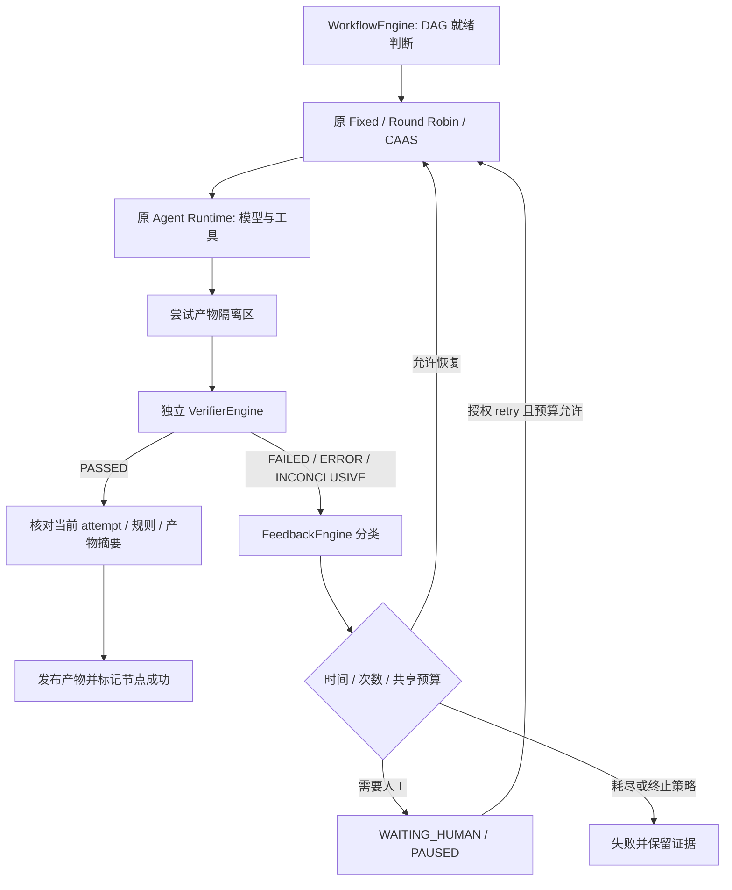

# 任务 06：可信验证与有界 Self-Loop

本阶段在任务 05 提交 `1f3f658349a58386e160e9b0d68ee4cca54e75de` 上继续开发，没有重复提交任务 05，没有 push。解释器为项目 `.venv` 的 Python 3.11.9。保留原有 183 项测试及其断言；新增 79 项自动化测试，合计 262 项。模型生成全部为 **MOCK SIMULATED**；验证、调度、工具执行、SQLite 审计和 HTTP 请求为实际运行，不代表真实 LLM 已自主修复。

## 1. 模块与依赖

| 层 | 文件 | 职责 |
| --- | --- | --- |
| domain | `verification.py` | 不可变规则、产物版本、证据、反馈、尝试记录；共享预算与尝试计量 |
| application | `verification.py` | VerifierEngine：独立验证、超时、异常隔离及结论聚合 |
| application | `feedback.py` | FeedbackEngine：分类、恢复策略选择，不自动归咎于 Agent 能力 |
| application | `selfloop.py` | SelfLoopEngine：单节点有界恢复，调用现有 Runtime 和调度器 |
| application | `ports.py` | VerificationBackend / SafetyRepository 可替换端口 |
| adapters | `verification.py` | JSON Schema、声明式断言、数值一致性、服务端注册的外部测试适配器 |
| adapters | `safety_store.py` | 与工作流共用 SQLite 连接的审计存储、版本核对、反馈去重、人工工单 |
| api | `verification.py` | 规则注册、验证/尝试/反馈/人工状态查询与受保护的人工决策 |

应用层不依赖 SQLite、jsonschema、HTTP 或哈希实现；哈希通过验证后端端口提供。复用既有 `Verification`、`Feedback`、`VersionRef` 和状态枚举，没有另造 Agent 执行系统。没有新增依赖或大型框架。

## 2. 工作流接入与状态机



任务节点配置 `verification: {id, version}` 才启用独立验证；未配置的旧工作流保持原执行语义、`verified=false`。原工作流控制循环与本阶段单节点恢复循环各自有边界，共享根工作流资源预算。子工作流继承同一资源账本，不能借嵌套重置额度。

节点经过 `READY → RUNNING → VERIFYING → RECOVERING → RUNNING`，通过后才 `SUCCEEDED`；可转 `WAITING_HUMAN`、`FAILED`、`CANCELLED`。存在人工等待时根报告显示 `PAUSED`，停止发起新的 READY 节点；已发起的并行节点可完成。人工处理期间整体超时继续计时。

`WorkflowEngine` 仍决定依赖、汇合和控制流，`SelfLoopEngine` 只管理一个任务节点的尝试，`SchedulingCoordinator` 仍完成候选过滤、策略选择和容量原子认领。每次重试使用新的 attempt ID 作为调度任务 ID，不复用旧任务认领。Prompt 重试固定原 Agent 的配置版本，仍经过调度器的技能、权限、可用性和容量检查；更换 Agent 时只在原始候选集合内排除先前失败者。

只有通过验证的当前产物进入成功节点输出和下游映射。失败节点输出保持 null；原 Runtime 的原始执行记录仍可用于诊断，其 `execution.state=succeeded` 只表示执行成功。工作流 `verified=true` 要求成功结果链中的 Agent 节点均已验证；未验证的旧节点不会被自动标成可信。子工作流和循环保守汇总子结果的 verified 状态。

## 3. 规则、证据及策略冻结

`VerificationPolicy` 包含 ID、版本、名称、checks、验证超时。同一 ID/版本不可覆盖；工作流注册时检查规则存在，运行时加载对应版本。`VerificationResult` 包含：

- 原有 Verification（ID、执行 ID、规则版本、结论、证据引用、原因码、时间）。
- run_id、节点实例 ID、attempt_id、产物 ID/版本及 SHA-256 摘要、规则摘要。
- 每项验证依据、耗时、实际检查次数、生成是否模拟、故障来源 artifact / execution / verifier。

复用领域枚举 `pass/fail/inconclusive/error`；验证查询 API 另提供 `PASSED/FAILED/INCONCLUSIVE/ERROR`。聚合优先级为 ERROR、FAILED、INCONCLUSIVE、PASSED；任何不确定或错误均不能发布。执行异常保留执行错误码，验证器错误不反射异常原文。

| check.kind | config 示例 | 行为 |
| --- | --- | --- |
| json_schema | `{"schema":{"type":"object","required":["answer"]}}` | 使用现有 jsonschema 依赖，失败保存结构路径和稳定原因码 |
| assertion | `{"path":"answer","op":"eq","value":42}` | 点路径；eq/ne/gt/gte/lt/lte，缺失或类型不兼容失败；不使用 eval |
| numeric | `{"path":"total","expected":42,"tolerance":0.001}` | 有限数值绝对误差；可指定 other_path 比较同一产物中的另一字段 |
| external_tests | `{"test_id":"preset-suite"}` | 仅调用服务端预注册异步测试适配器；证据必须引用该产物摘要 |

当前 JSON Schema 有意限制大小和结构复杂度：规则总序列化长度最多 65,536 字符、schema 深度最多 16、最多 512 个结构项；禁止 `$ref/$dynamicRef/$recursiveRef`、正则相关关键词和 format。正则同步执行不能被 asyncio 超时安全中断；format 在没有检查器时不能被默认为已验证。需要这些能力时应接入独立受限验证进程，而非放宽当前实现。规则对象中同名保留键也会被拒绝。

外部测试结果不能由模型生成的 `passed=true` 充当。没有服务端证据时是 INCONCLUSIVE；回调报错、返回非法结论或摘要不一致时是 ERROR。回调是可信、需遵循取消和超时的服务端扩展代码，并非安全沙箱。预留交叉验证及 LLM 辅助适配器边界，没有实现或宣称 LLM 自评为客观证明。

## 4. 错误分类与恢复

分类包含 OUTPUT_FORMAT_ERROR、ASSERTION_FAILED、TOOL_EXECUTION_ERROR、AGENT_CAPABILITY_MISMATCH、TIMEOUT、RESOURCE_UNAVAILABLE、UNKNOWN。能力不匹配类别保留给显式能力证据，不根据一次验证失败臆测。

| 恢复动作 | 实现语义 |
| --- | --- |
| prompt_retry | 保留原输入，加可信规则及结构化失败原因；不改 System Prompt、不改规则；新 attempt |
| reassign | 对格式/断言等产物错误，达到 reassign_after 后在原候选中另选 Agent；消耗重规划预算 |
| tool_switch | 使用预先配置的工具白名单子集；不得扩大 Agent 权限，Runtime 再次校验 |
| fallback | 仅激活明确声明的 `branch: "fallback"` DAG 边，源节点仍 FAILED；只输出备用成功节点产物 |
| human | 持久化工单并暂停；只能授权 retry 或 abort，不允许强制 PASSED、增加权限或修改规则 |
| abort | 停止当前恢复并保留全部尝试、验证及反馈证据 |

请求 reassign 时，工具/超时/资源/未知执行故障不会被当成能力不足而自动排除 Agent；工具故障有批准的替代子集时选 tool_switch，否则原 Agent prompt_retry。验证器 ERROR/INCONCLUSIVE 使用独立的 `on_uncertain`（默认 abort，可 human）。恢复依然受所有次数和时间限制。

CAAS 原执行成功统计与验证质量分开：验证节点实际 Runtime 成功时更新原执行统计，验证失败不会写成执行失败；工具、外部环境、模型调用异常不自动负向更新能力画像。所有确定性质量证据保存在独立验证记录中，可按 attempt 关联 Agent；本阶段没有把质量分数混入既有 CAAS 权重。Fixed 和 Round Robin 采用同一恢复入口与限制。

`fallback` 路径仍须满足普通 DAG 无环及映射约束。正常路径失败后跳过，备用路径通过时可以使工作流成功，但源节点失败证据保留。显式 fail_fast 优先终止整个工作流；需要备用路径的工作流应采用 continue 策略。

## 5. 有界预算、取消与持久化

单节点 RecoveryLimits 默认：max_attempts=1、max_feedback_loops=0、max_replans=0、timeout_seconds=30、on_failure=abort、on_uncertain=abort；默认没有自动重试。上限分别为 16 次尝试、15 次反馈、15 次重规划、300 秒。另有每次 Runtime RunLimits、节点/根工作流超时、原 DAG 节点及子流程深度限制。

根 WorkflowDefinition 可配置 `resource_limits`：

| 限制 | 默认值 | 含义 |
| --- | --- | --- |
| max_calls | 128 | 根内模型与工具调用总次数，包括失败调用 |
| max_resource_units | 1,048,576 | 请求负载与输出上限的预收费单位 |
| max_checks | 512 | 验证 check 调用次数 |
| max_attempts | 64 | 已启用验证的全部任务尝试数，包含无候选的尝试 |
| max_feedback_loops | 32 | 已应用恢复动作数 |
| max_replans | 16 | Agent 更换、工具子集更换和备用路径次数 |

resource_units 的模型收费为请求 messages 的 UTF-8 序列化字节数加 max_output_tokens，工具收费为 arguments 序列化字节数；这是可重复的请求准入单位，**不是实测 token、费用或供应商硬账单限制**。另累计供应商实际报告 token；缺失/失败调用的用量用 unknown_usage_calls 显式标记，Mock 不伪造用量。没有实现真实货币预算、OS CPU/内存隔离。

共享账本在同一个事件循环内同步检查并扣费；尝试使用子账本同步扣父账本，每个 attempt 的资源记录不会混入并发任务用量。attempt.resources 记录该次执行与验证消耗，反馈单独保存计划 budget_cost 和实际 actual_budget_cost；session.usage 与根报告 resource_usage 是共享根账本快照。

取消传播到等待中的调度、Runtime 模型/工具、异步验证回调及人工等待；终止后不发布失败产物。整体超时不因重试、工具更换或人工等待而重置。没有实现无限制 Shell、Python 执行器、任意代码测试程序、文件删除器。

SQLite 中规则、验证、反馈及反馈应用记录不可覆盖，尝试在终态后不可修改，更新使用 revision 检查；发布同时核对 session.current_attempt、规则摘要、产物版本/摘要和 PASS 记录。旧反馈、重复应用、过期工单均拒绝。重启把 created/running/paused 的工作流标记中断失败并使工单过期，不自动续跑或重放副作用。

## 6. API 与权限

所有接口沿用 `/api/v1`：

- `POST /verification-policies`，`GET /verification-policies`，`GET /verification-policies/{id}?version=1`。
- `GET /self-loops/{node_instance_id}`：状态、接受产物及共享预算快照。
- `GET /self-loops/{node_instance_id}/attempts`：输入版本、Agent/模型、调度决策、原始尝试产物、时间及资源。
- `GET /self-loops/{node_instance_id}/verifications`，`GET /self-loops/{node_instance_id}/feedback`。
- `GET /human-interventions?node_id=...`，`POST /human-interventions/{ticket_id}/resolve`。

node_instance_id 来自工作流报告 `nodes[].id`，不是定义中的 `nodes[].node_id`。

人工 resolve 必须在服务端进程环境配置 `FUTURECUP_APPROVAL_TOKEN`，并使用 `X-Harness-Approval-Token` 请求头；通过常量时间比较。不配置时默认拒绝，身份字段 actor 是审计声明，不是独立验证的用户身份。请求还须提交 ticket.revision、attempt_id、artifact_ref 及 retry/abort，防止旧授权作用于新产物。令牌不写入日志或返回对象，不在仓库提供真实示例值。

其他接口仍是原有可信本地开发 API，没有完整认证、RBAC、租户隔离、输入秘密自动识别、加密审计或公网安全保障。尝试查询包含任务输入和产物，仅应对可信本地用户开放，不含 Agent 私有 System Prompt；不要把凭据作为任务内容。只监听 127.0.0.1、单 worker，不向公网部署。

## 7. 可复制命令与实测结果

在项目根目录执行：

```powershell
.\.venv\Scripts\python.exe -m pytest backend/tests -q --junitxml=.data/pytest-06.xml
.\.venv\Scripts\python.exe -m compileall -q backend/src backend/tests backend/scripts
.\.venv\Scripts\python.exe -m pip check
.\.venv\Scripts\python.exe backend/scripts/run_selfloop_demos.py
.\.venv\Scripts\python.exe backend/scripts/check_verification_api.py
```

启动交互开发服务（仅本地）：

```powershell
$env:FUTURECUP_ENABLE_REAL_LLM = 'false'
.\.venv\Scripts\python.exe -m uvicorn futurecup.api.app:app --host 127.0.0.1 --port 8000
# 在另一个项目终端检查：
Invoke-RestMethod 'http://127.0.0.1:8000/api/v1/health'
```

`examples/selfloop/A.json` 至 D.json 可通过原 `POST /workflows` 提交。它们引用 `answer-policy@1` 及演示 Agent；完整初始化和场景专用 Mock Provider 由演示脚本完成，普通服务默认 mock-echo 不会自动模拟“修复成功”。API 冒烟脚本自行启动并停止独立 Uvicorn 进程，不关闭用户的其他服务。

| 案例 | 实际尝试 | 验证结论 | 终态 |
| --- | --- | --- | --- |
| A：格式修正 | a-primary × 2 | FAILED → PASSED | SUCCEEDED、verified=true |
| B：连续失败后换 Agent | a-primary × 2 → b-backup | FAILED → FAILED → PASSED | SUCCEEDED、verified=true |
| C：反复失败 | a-primary × 3 | FAILED × 3 | FAILED、recovery_limit、无发布产物 |
| D：缺少可信外测证据 | a-primary × 1 | INCONCLUSIVE | FAILED、verification_inconclusive |
| D：验证器异常 | a-primary × 1 | ERROR | FAILED、verification_error |

完整尝试、产物、验证证据、反馈和决策实际写入 `.data/selfloop-06-demos.json`。首次案例 B 检查发现固定策略按 ID 字典序先选 backup；已将演示 ID 明确设为 a-primary / b-backup，保持固定基线算法原样，然后实际重跑得到上表。未更改验证标准或伪造结果。

实测自动化：原 183 项加新增 79 项，共 262 项通过，无删除/跳过/弱化旧测试。覆盖 schema、断言、数值、外部验证报错/超时/无证据、分类、原 Agent 修复、三策略重调度、工具权限及真实工具异常、反馈/重规划/共享预算、取消到 Runtime 和验证器、并发隔离、嵌套共享预算、产物篡改、旧反馈/重复反馈拒绝、审计持久化、重启工单过期、API 错误及人工权限。存在原 Starlette TestClient/HTTPX 弃用警告，未屏蔽；无配置 mypy/Ruff，compileall 和依赖边界检查不等于完整类型检查。

真实本地 HTTP 冒烟：health 200（`{"status":"ok","scope":"process"}`），创建 Agent/规则/工作流均 201，执行提交 202，报告/验证查询 200，Mock 结果 verified=true 且 PASSED。证据 `.data/api-06-http.json`、服务日志 `.data/api-06-uvicorn.log`；检查后服务进程停止。

## 8. 文件与阶段边界

新增：domain/verification.py；application/{verification,feedback,selfloop}.py；adapters/{verification,safety_store}.py；api/verification.py；tests/{verification_support,test_verification_selfloop,test_verification_api}.py；scripts/{run_selfloop_demos,check_verification_api}.py；examples/selfloop/{A,B,C,D}.json；本文。

修改：domain/{models,scheduling}.py；application/{ports,runtime,scheduling,workflow,workflow_validation}.py；adapters/workflow_store.py；api/{app,workflows}.py；bootstrap.py；README.md；architecture.md；.env.example。未修改现有测试文件、前端或依赖声明。`.data` 证据、虚拟环境和缓存被 .gitignore 排除。

尚未实现：真实 LLM 修复效果评估、交叉 Agent / LLM 辅助验证、隔离代码沙箱、真实费用预算、认证与多租户、跨进程原子容量、持久化 Agent 注册及 Runtime 全记录、自动崩溃续跑、签名/防篡改审计、自动从质量证据训练 CAAS、Vue 可视化。SQLite 审计依赖可信本地文件，SHA-256 绑定版本不代表能抵抗拥有数据库写权限的攻击者。

待负责人审核：规则可信来源及冻结流程、默认预算与 schema 子集、故障分类和重分配阈值、质量画像的后续统计口径、人工授权身份体系、外部测试隔离方案及真实模型评估数据。本阶段到此停止。
