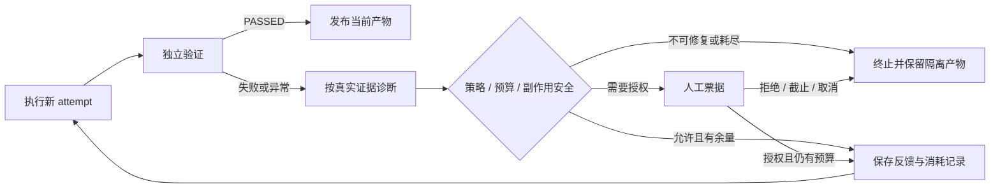

# 14-C：精准修复与显式局部恢复

本阶段继续使用原 WorkflowEngine、Runtime、VerifierEngine、FeedbackEngine、调度器和 SQLite Repository，不另建编排系统。未新增依赖。默认旧行为保持兼容。

## 入口与状态迁移

节点通过 `config.recovery.precise=true` 启用精准策略；最大尝试数、反馈循环数、重规划数、超时和预算仍由原 recovery / resource_limits 控制。诊断允许动作与配置动作取交集，不扩大权限。



现有节点状态与尝试状态继续使用。失败产物只在 attempt artifact 中保留，不写成节点成功输出；只有独立验证 PASS 才 publish。每轮上下文携带真实上一产物、摘要、attempt ID、验证 ID/失败证据和 FeedbackEngine 策略。

## 终态后的显式跨运行恢复

接口：`POST /api/v1/workflow-runs/{run_id}/recover`，HTTP 202。

```json
{
  "request_id": "operator-repair-001",
  "expected_revision": 12,
  "authorize_recovery": true,
  "invalidated_nodes": [],
  "authorize_effects": false
}
```

以上 revision 仅为格式示例，必须读取实际源运行的修订。新入口用于可信本地开发，不是多租户鉴权边界。`authorize_effects=true` 是明确的操作员再次执行确认，不得自动勾选；已有人工票据 API 的安全要求保持不变。

1. 仅接收终态 FAILED、修订一致、原 deadline 尚未耗尽的运行。
2. 真实或未知 Provider 运行拒绝：`recovery_real_budget_unprovable`。本阶段仅允许全部候选 Provider 明确 `is_simulated=True`。
3. 读取原 WorkflowDefinition、Agent 版本绑定、尝试/验证/反馈、知识检索快照。只复用已验证的 TASK 节点。
4. 复用条件：成功状态、产物摘要、PASS 证明、验证策略摘要、Agent 绑定版本、重新解析输入、知识库/文档版本与哈希全部一致。
5. 未验证节点、显式失效节点、控制节点及它们的传递后继失效。普通 DAG 的所有数据引用仍必须受原依赖合法性规则约束。
6. 条件和汇合重新计算；未选分支仍 SKIPPED。循环和子工作流重新进入原引擎，创建新 child_run_id，不借用过期控制输出。
7. 创建全新运行 ID。源快照不修改；复用节点带 `reused_from` 来源/产物/验证引用，不创建假的新 execution_id、attempt 或模型调用。
8. 只有输入摘要与节点版本绑定仍相同的失败节点，才接收源运行的真实失败上下文。上游变化后拒绝过期反馈。

### 预算认领

恢复继承原始整体 deadline、已用节点次数，以及共享调用、尝试、工具、验证、Token 等已用计数；先消耗一次共享反馈额度。只允许一代显式跨运行修复。SQLite `workflow_repair_claims.source_id` 唯一约束与新运行插入同事务完成：同 request_id / 参数重复请求返回同一运行；不同参数或新 request_id 拒绝。服务或 Repository 重新创建后认领仍有效。

Mock 源切换到真实 Agent 的风险采用双层防护：准备阶段检查所有候选 Provider；继承预算带 `simulation_only=True`，Runtime 在读取凭据校验或调用 Provider 之前沿预算父链再次拒绝非模拟 Provider。测试替身验证拒绝先于 Provider.validate / infer。没有跨运行真实金额及逐节点预留的可信来源，不能推测剩余额度或重新设置真实预算。

### 工具重放

工具元数据 `retry_safety`：`none`（声明无副作用）、`idempotent`、`irreversible`、`unknown`（默认）。精准模式对后两者重试前进入人工处理。

`idempotent` 在同一重放域内以工具版本和参数摘要建立 single-flight 任务，安装 ledger 条目后才 await。并发相同调用复用一次执行；参数不同拒绝 `tool_replay_conflict`。失败/取消后的不确定结果拒绝 `tool_replay_uncertain`。参数在调度前复制，结果在存入 ledger 前复制，返回时再次复制，避免调用者或 handler 修改缓存证据。

跨运行默认只复用仍完整、成功的同域幂等 ledger；丢失 ledger、未知副作用或控制子树没有安全重放证明时拒绝，要求显式人工确认。原业务必须提供正确的幂等语义；本地账本不是外部系统幂等键或事务的替代品。

## 可观测性与成本

- 节点：`repair_diagnosis`、`prior_feedback`、`reused_from`。
- 根报告：`recovery_audit` 中保存源 ID/revision、认领请求、保留/失效节点、失败证据归因、人工副作用授权、资源 before/delta/after、最终状态与验证结果。
- `reexecuted_nodes` 的粒度是根层有 Agent 执行、attempt 或 child_run 的工作节点；纯条件/汇合重算见事件，嵌套节点见新 child_run_id 对应报告。不要把根数组解释为完整递归执行列表。
- 调度评分/Agent 分配继续查原决策记录，尝试和验证保留现有审计引用。Vue 执行详情新增复用来源提示和恢复摘要；复用结果不会展示为新模型推理。
- 无可靠局部/全量真实费用估计时，`cost_comparison.basis=unknown`，保守复用有完整证明的节点并拒绝真实跨运行恢复。模拟单位不代表供应商 Token 或账单。

## 验证与操作

免费验证（无需启动服务、无需密钥）：

```powershell
Set-Location D:\competition\FutureCup-v1.1
.\.venv\Scripts\python.exe -m pytest backend/tests/test_precise_recovery_14c.py -q
.\.venv\Scripts\python.exe scripts/check_local_recovery_14c.py --output results/selfloop-14c/local-replay-new
.\.venv\Scripts\python.exe scripts/bench_selfloop_14c.py --seeds 20 --output results/selfloop-14c/replay-new
```

输出目录必须尚不存在；脚本拒绝覆盖旧结果。全部使用 Mock 和内存/独立临时 SQLite；不会连接原项目。当前旧入口也可继续按原方法启动 v1.1 Mock 服务，新模式需要显式配置/请求，不自动重放历史记录。

## 已知边界与后续建议

- 跨运行真实模型恢复仍被禁止；下一步需独立持久化金额预留、父任务配额及逐节点用量来源后才能评审开放。
- 工具 ledger 仅在进程内，不提供崩溃后 exactly-once。进程重启后的不确定副作用须对账、外部幂等键或人工处理。
- 依赖可信工具的正确标注与合作取消；没有新增任意代码沙箱或非合作外部进程强杀机制。
- 复用证明检查版本和数据摘要，不自动证明外部测试 handler 的实现没变；应保持验证器版本不可变，后续补实现指纹与工具 ledger 持久化。
- 控制与子树采用保守重算，未实现全图最小重算优化、任意多代恢复或分布式恢复。
- 未新增 Python 静态类型检查器，使用现有类型注解、接口/运行测试及 compileall；不把编译检查称为完整类型检查。
- 保留的 Starlette/httpx 弃用提示不影响当前测试，依赖升级另行验证。本阶段 npm 审计使用离线缓存，不能代表最新漏洞库。
